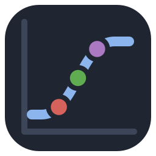

# PsychophysicsManager.jl (PEM)

[](https://github.com/tsurkys/PsychophysicsManager.jl/actions/workflows/CI.yml)

Psychophysical Experiment Manager (PEM) is a modular Julia package for managing psychophysical measurements: experimental designs, constant-stimuli / adjustment / adaptive methods, per-trial checkpointing and non-destructive corrections, an operator dashboard, session combining and export, and programmatic model observers.

Stimulus presentation is decoupled from the headless core: built-in visual (`GLMakie`) and auditory (`PortAudio`) engines live in package extensions, external stimulus programs (such as MATLAB/Psychtoolbox or Python/PsychoPy) connect over a line-delimited JSON protocol (`RemoteEngine`), and vision-language models can participate through the same apparatus (`OffscreenVisualEngine` + `ModelObserverSource`).

**Status:** under development and not yet registered; the interface and the session file format may change before v1.0. Intended for Windows, Linux and macOS; developed on Linux with Julia 1.13.

## Quick Start

With Julia installed (`juliaup` on any platform; on Windows run the commands in PowerShell):

```bash
git clone https://github.com/tsurkys/PsychophysicsManager.jl
cd PsychophysicsManager.jl

# Install the dependencies and run the test suite
julia --project=. -e 'using Pkg; Pkg.instantiate(); Pkg.test()'

# Open the operator dashboard (the examples/ environment adds the GUI backends)
julia --project=examples -e 'using Pkg; Pkg.instantiate()'
julia examples/save_templates.jl   # first run: generate example templates
julia examples/run_dashboard.jl
```

On a GNOME desktop the dashboard shows the package logo in the task bar and the window switcher once `install_desktop_icon()` has written its desktop entry: `julia --project=. -e 'using PsychophysicsManager; install_desktop_icon()'`.

## Documentation

- [`docs/STIMULI.md`](docs/STIMULI.md) — Reference visual and auditory stimuli and how to register custom stimuli and engines.
- [`docs/AI_OBSERVER.md`](docs/AI_OBSERVER.md) — Running psychophysical sessions with simulated and vision-language model observers.
- [`docs/CONTROL_CHANNEL.md`](docs/CONTROL_CHANNEL.md) — Controlling a running operator dashboard from Python, MATLAB, or AI agents.
- [`workers/README.md`](workers/README.md) — External presentation worker protocol (`RemoteEngine`) and the Psychtoolbox reference worker.
- [`examples/README.md`](examples/README.md) — Executable example scripts and hardware diagnostics.
- [`settings.toml.example`](settings.toml.example) — Documented configuration template.
